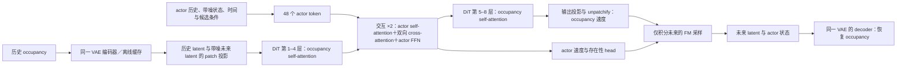

# ReactOccFlow：面向闭环驾驶的反应式占据流世界模型

> 2026-11-02 最新架构决定：恢复原 OccFM 式 U 形 DiT 为默认主干，同时保留 `backbone=dit` 的标准 DiT。两个分支均支持三种研究模式；原删除限制已被本次决定替代。训练继续暂停，既有 DiT 冻结源码和恢复入口保持不变。详见 [双架构恢复说明](docs/implementation/2026-11-02-restore-unet-and-keep-dit.md)。

更新日期：2026-10-31。研究主干现为标准 DiT，采用模态内 self-attention 与 occupancy–actor 双向 cross-attention。本文中的 PlanFlow 学习、动作干预、风险校准及闭环收益属于研究目标；当前 DiT 已通过工程短跑验收，尚无全量训练或研究效果结论。旧 U-Net 实验独立保留，不能作为 DiT 的训练进度。实现与验证边界见 [标准 DiT 迁移记录](docs/implementation/2026-10-31-standard-dit.md)。

## 1. 研究动机

Flow Matching（FM）已经被用于驾驶视频、LiDAR、occupancy 以及 world-action 模型，但现有工作对“自车动作如何改变周围交通参与者反应”的显式建模仍然不足。

已有工作分别覆盖了不同能力：

- [OccFM](https://arxiv.org/abs/2506.23434)：latent flow matching 用于 LiDAR/occupancy 世界模型。
- [OccSim](https://arxiv.org/abs/2603.28887)：长时域 occupancy 世界模型驱动的仿真。
- [AutoWorld](https://arxiv.org/abs/2603.28963)：多智能体交通仿真。
- [OccWAM](https://arxiv.org/abs/2610.17688)：联合生成 occupancy 和自车轨迹。
- [PhysWAM](https://arxiv.org/abs/2609.37970)：通过深度–运动几何约束提高物理一致性。
- [DriveWAM](https://arxiv.org/abs/2605.28544)、[WA-JEPA](https://arxiv.org/abs/2608.20974)：视频/未来 latent 与动作联合建模。

本方案的目标是构建一个 **occupancy-native 的反应式世界模型**：给定当前场景和一条候选自车轨迹，生成对应的未来 occupancy、周围交通参与者运动，并估计该轨迹的闭环风险。

暂定论文标题：

> **ReactOccFlow: Risk-Calibrated Reactive Occupancy Flow Matching for Closed-Loop Autonomous Driving**

## 2. 核心问题

给定历史传感器观测、地图和候选自车轨迹，模型需要学习：

1. 未来场景 occupancy 如何演化；
2. 周围车辆和行人如何响应自车动作；
3. 不同候选轨迹对应的碰撞风险和预测不确定性。

目标分布可以写为：

$$
p(O_{1:H}, A_{1:H} \mid S_0, E_{1:H})
$$

其中：

- $S_0$：当前场景表示；
- $E_{1:H}$：候选自车轨迹；
- $O_{1:H}$：未来语义 occupancy；
- $A_{1:H}$：周围车辆和行人的未来运动。

## 3. 模型结构

### 3.1 场景编码器

完整系统拟使用的输入包括：

- 历史多相机和 LiDAR 特征；
- 当前 BEV/occupancy 特征；
- HD map 或矢量地图；
- 导航路线；
- 当前自车状态。

编码器输出场景 latent $S_0$，并保留 scene-centric 坐标系和 ego-centric 坐标系之间的 SE(2) 变换。

当前研究实现使用 E0 坐标下的 oracle occupancy latent 和当前/历史 actor 观测。真实传感器前端、地图/导航接入和训练后的感知质量仍需后续验证。只有一套 occupancy VAE：历史观测与未来训练标签各自经同一编码器离线缓存，未来标签只用于监督。actor 通过状态编码 MLP 构造 token，不经过 occupancy VAE。

### 3.2 PlanFlow：自车候选轨迹生成

PlanFlow 使用条件 Flow Matching 生成多模态自车候选轨迹：

$$
E^{(k)}_{1:H}=\{x_t,y_t,\theta_t,v_t\}_{t=1}^{H}
$$

候选轨迹应覆盖跟车、停车、减速、绕行和变道等行为模式。与单一回归轨迹相比，FM 可以保留多峰动作分布。

### 3.3 ReactFlow：动作条件的未来世界生成

对每条候选自车轨迹，ReactFlow 联合生成：

$$
Z_{1:H}=[O_{1:H},A_{1:H},D_{1:H}]
$$

其中：

- $O$：未来语义 occupancy latent；
- $A$：周围车辆和行人的轨迹 token；
- $D$：由 actor 状态中的速度及其时间差分得到的运动量；当前不另设独立的 $D$ 生成分支。

occupancy 速度网络现支持两种主干：默认恢复原 U 形时空 DiT，在瓶颈后交换 actor；标准 DiT 分支保留如下设计：

- 将 6 个历史槽与 6 个带噪未来槽组成的 latent 序列切成空间 patch；单帧 latent 为 `16×50×50`，patch 为 `5×5`，每块 `400→256` 线性投影，共得到 1,200 个 token。
- 在固定 token 分辨率上堆叠 8 层、256 维、8 头的 DiT Block。occupancy token 之间做全局时空 self-attention；生成时间和候选轨迹通过条件编码调制 adaLN。
- 8 个当前观测选中 actor、6 个未来槽构成 48 个 128 维 token。第 4 个 DiT Block 后接两层、4 头交互模块，每层先做 masked actor self-attention，再同步计算两路 cross-attention，最后更新 actor FFN。
- actor 更新使用 `Q=actor, K/V=occupancy`；occupancy 更新使用 `Q=occupancy, K/V=actor`。occupancy 在交互前投影为 128 维，交互增量回投到 256 维后进入后 4 层 DiT。
- occupancy 和 actor 保持两条 token 序列；分别输出 occupancy/actor 的生成流速度，actor 存在性由独立 head 输出。occupancy 输出投影与 unpatchify 恢复 latent 张量形状，随后通过 FM 采样得到未来 latent，再交给原 VAE decoder。

DiT patch 投影是 latent 到 token 的线性映射，不是第二套 VAE。训练 step 不重新运行 VAE encoder；冻结的 decoder 对预测端点解码，以计算可微一致性损失。

Flow Matching 目标为：

$$
\mathcal{L}_{FM}=\left\|v_\theta(z_t,t,c,E)-(z_1-z_0)\right\|_2^2
$$

模型可以采用 scene-centric 和 ego-centric 两阶段生成：先在全局场景坐标下预测未来世界，再按照候选自车轨迹重索引到未来 ego 坐标，完成动作对齐的 refinement。

## 4. 关键创新

### 4.1 显式反应式世界建模

邻居轨迹显式条件于自车轨迹，使同一场景下的刹车、加速和变道能够产生不同的周围交通响应，而不是只预测与自车动作弱耦合的未来 occupancy。

### 4.2 Occupancy-native 交互一致性约束

在 FM 目标之外加入三类约束：

$$
\mathcal{L}=\mathcal{L}_{FM}+\lambda_1\mathcal{L}_{warp}+\lambda_2\mathcal{L}_{int}+\lambda_3\mathcal{L}_{kin}
$$

- $\mathcal{L}_{warp}$：occupancy 与目标轨迹之间的空间变换一致性；
- $\mathcal{L}_{int}$：基于 TTC、occupancy overlap 和安全距离的交互约束；
- $\mathcal{L}_{kin}$：自车和邻居车辆的速度、加速度、转向角约束。

相比 PhysWAM 的深度–运动约束，本方案直接在 occupancy 和轨迹空间中建立约束，不依赖额外的 RGB 或 metric depth 生成分支。

### 4.3 风险校准的多样本轨迹选择

对每条候选自车轨迹采样多个未来世界：

$$
\{(O^{(k,m)},A^{(k,m)})\}_{m=1}^{M}
$$

根据多次采样计算：

- 碰撞概率；
- TTC；
- 越界概率；
- occupancy 预测方差；
- 路线进度和舒适性。

在验证集上使用温度校准或 isotonic calibration，使模型输出的风险概率具有实际含义。最终选择：

$$
E^*=\arg\min_E \operatorname{Cost}(E)
\quad\text{s.t.}\quad
P_{\mathrm{collision}}(E)<\tau
$$

## 5. 实验设置

### 5.1 数据集

第一阶段建议使用：

- nuScenes：训练、开放环预测和 occupancy 评估；
- Bench2Drive：闭环驾驶评估；
- 可选 CARLA 或 OccSim 生成同一初始场景下的多种自车动作，用于验证反应式建模。

建议先限制规模：

- 预测时长 3 秒；
- 当前主实验 occupancy 分辨率 0.4 m，保持 `200×200×16` 网格与已有 VAE 兼容；0.5 m 作为重新制备标签与缓存后的单独消融；
- 最近 8 个交通参与者；
- 每个场景 8 条候选自车轨迹；
- 4 或 8 步 ODE 采样。

### 5.2 对比方法

建议至少比较：

- OccFM；
- OccSim 的 occupancy world model；
- AutoWorld；
- OccWAM；
- PhysWAM；
- 一个普通 occupancy diffusion 或 autoregressive baseline。

### 5.3 评价指标

世界模型指标：

- future occupancy mIoU；
- dynamic occupancy IoU；
- agent ADE/FDE；
- energy score；
- occupancy calibration error。

规划与闭环指标：

- collision rate；
- collision per kilometer；
- route completion；
- off-road rate；
- TTC violation；
- comfort；
- inference latency；
- Flow Matching 的 NFE。

最关键的实验问题是：

> 在相同 occupancy 预测精度和相同采样步数下，ReactOccFlow 能否降低闭环碰撞率，并让风险概率更可靠？

## 6. 消融实验

至少包括：

1. 只生成 occupancy，不生成邻居轨迹；
2. occupancy 与邻居轨迹并行生成；
3. occupancy、邻居轨迹、自车轨迹联合生成；
4. 去掉 $\mathcal{L}_{warp}$；
5. 去掉交互损失 $\mathcal{L}_{int}$；
6. 去掉风险校准；
7. 比较 4、8、16 个 Flow Matching 采样步；
8. 比较不同候选轨迹数量；
9. 比较 scene-centric、ego-centric 和 scene-to-ego 两阶段坐标建模。

一个有说服力的结果是：去掉显式邻居反应分支后，开放环指标变化有限，但闭环碰撞率明显上升。

## 7. 预期贡献

1. 提出一个 occupancy-native 的反应式世界模型，联合生成自车轨迹、邻居运动和未来 occupancy。
2. 提出交互一致性 Flow Matching 目标，使自车动作能够改变周围交通参与者的预测分布。
3. 提出面向闭环规划的多样本风险校准和轨迹选择方法。
4. 在 nuScenes 和 Bench2Drive 上统一验证预测质量、风险校准和闭环安全性。

## 8. 实施路线

### 阶段一：复现基线

复现 occupancy latent 编码器、单条件 Flow Matching 预测器和基础轨迹规划器，先完成 3 秒开放环预测。

### 阶段二：加入联合生成

将邻居轨迹 token 接入 occupancy flow，并比较并行生成和联合生成两种结构。

研究主干可选择原 U 形时空 DiT（默认）或上述标准 DiT；VAE 保持冻结。两种结构均支持 occupancy–actor 联合训练。新实验默认随机初始化，U 形主干可显式使用原 OccFM 权重初始化；已有权重、训练曲线和暂停状态分别归属各自架构，不混用。

### 阶段三：加入交互约束

实现 occupancy warp、TTC/安全距离和运动学约束，检查其对开放环和闭环指标的影响。

### 阶段四：风险校准与闭环评估

对候选轨迹进行多样本 rollout，完成风险校准、轨迹筛选和 Bench2Drive 闭环评估。

### 阶段五：效率优化

测试少步 ODE、蒸馏或 MeanFlow 风格的一步/少步推理，报告性能与速度的权衡。

## 9. 主要风险与应对

- **数据缺少同一初始场景下的多种自车动作。** 使用 CARLA、OccSim 或反事实轨迹重采样构造动作条件训练样本，并把真实日志用于主要评估。
- **occupancy 标签稀疏或噪声较大。** 先在 BEV occupancy 和动态目标框上验证，再逐步加入更高分辨率 occupancy。
- **联合生成导致训练不稳定。** 采用 scene-centric 预训练，再加入 ego-centric refinement；先固定 PlanFlow，再训练 ReactFlow。
- **闭环平台复现成本高。** 先用离线反事实风险评估，再迁移到 Bench2Drive 闭环。
- **创新点与 OccWAM 重叠。** 将重点放在“邻居反应建模 + 交互约束 + 风险概率校准”，而不是简单重复 occupancy/action 联合 FM。

