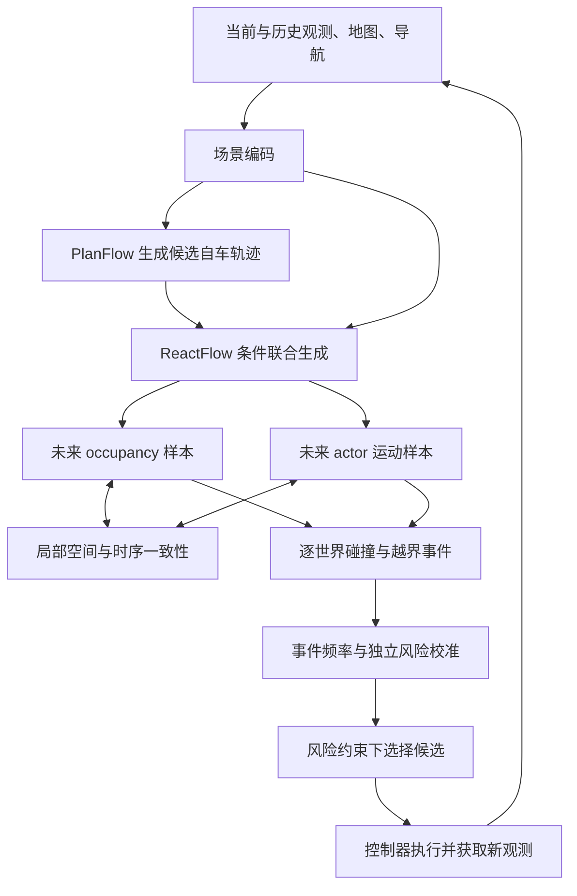

# ReactOccFlow：科学问题、解决机制与验证方案

**创建日期：2026-10-27；架构同步：2026-10-31。** 对应[方案](./ReactOccFlow方案.md)、[实施计划](./docs/superpowers/plans/2026-10-27-reactoccflow-implementation-plan.md)与[参考文献](./ReactOccFlow参考文献.md)。当前实现采用标准 DiT，旧 U-Net 训练与新 DiT 的证据分别记录于[迁移说明](./docs/implementation/2026-10-31-standard-dit.md)。

> 本文是研究设计说明，不是实验结果报告。“解决”指拟采用的建模与验证路径；所有性能收益、机制解释和贡献强度都需要实验确认。文献编号沿用已有的 30 篇参考文献清单。本次同步修改 Markdown，不新增训练或实验结果。

## 1. 本篇论文究竟研究什么

本篇论文拟研究的核心科学问题是：

> **在相同历史观测下，如何学习随候选自车动作变化、且占据空间与交通参与者运动相互一致的多模态未来世界分布，并将有限次世界采样转化为可校准、可用于闭环选择动作的风险估计？**

这包含一条需要逐段验证的逻辑链：

**自车动作变化 → 邻居响应变化 → 未来 occupancy 变化 → 风险估计变化 → 闭环决策变化。**

论文不能只证明“多加一个轨迹分支后指标提高”。它需要回答：联合生成是否使世界预测更符合交互过程；这种改善是否提供了更可靠的候选动作风险；规划器是否利用这些信息获得更好的安全性与通行效率。

### 1.1 一个具体例子：自车汇入主路

当前观测固定，自车面对三条候选轨迹：减速等待、适度加速汇入、强行切入。

- 减速等待时，后方主路车辆可能继续行驶。
- 适度加速汇入时，主路车辆可能减速让行，也可能维持速度。
- 强行切入时，可能出现急刹、避让或碰撞；不能预设其他车辆总会让行。

合格的世界模型应给出各候选动作下不同的未来分布，并让“邻车轨迹经过的位置”和“未来车辆 occupancy 出现的位置”保持对应。它还应保留危险分支的概率，而不是把所有未来都修正成安全状态。

规划器随后比较的是各动作对应的完整未来分布。只预测一条最可能邻车轨迹，或者给所有候选复用同一份未来场景，都难以充分支持这种比较。

### 1.2 论文的研究对象与工程对象

| 层次     | 具体对象                                  | 需要证明的内容                                   |
| ---------- | ------------------------------------------- | -------------------------------------------------- |
| 科学问题 | 动作条件下的交互世界分布                  | 是否能建模正确的响应变化，而不仅是条件输入敏感性 |
| 核心方法 | occupancy–actor 耦合的条件 Flow Matching | 是否改善空间、运动和交互的一致性                 |
| 决策方法 | 多世界采样、风险校准和轨迹筛选            | 概率是否可靠，决策是否因此受益                   |
| 工程载体 | 独立的 ReactOccFlow 项目                  | 可复现、可运行，删除参考仓库后仍独立             |

工程独立性是实现要求，不应写成论文的方法创新。

## 2. 已有研究做到哪里，本方案还需要证明什么

以下比较依据已有文献清单，作用是划定本方案的贡献边界，不代表已经复现全部方法。

| 已有工作                                        | 已覆盖的能力                                            | 本方案需要进一步回答的问题                                     |
| ------------------------------------------------- | --------------------------------------------------------- | ---------------------------------------------------------------- |
| OccFM [1]                                       | occupancy latent 的 Flow Matching，包含未来自车轨迹条件 | 显式 actor 状态与 occupancy 的耦合，能否改善交互分布和决策风险 |
| OccWAM [2]                                      | occupancy 与自车动作联合 FM，scene-to-ego 生成          | 给定候选动作后，邻居响应与 occupancy 能否形成一致的条件分布    |
| AutoWorld [9]、TrafficSim [17]                  | 世界模型或多主体行为仿真                                | 本方案的耦合结构和干预评测是否提供额外收益                     |
| PhysWAM [10]                                    | 通过几何相关约束提高世界–动作一致性                    | occupancy 与 actor 几何、运动约束是否适合当前表征和风险推断    |
| M2I [18]、GameFormer [19]、DTPP [21]            | 交互预测、主体响应或 ego-conditioned 预测–规划         | 引入 occupancy 联合流之后是否超出已有交互预测的效果            |
| DIPP [20]、Contingencies from Observations [22] | 预测–规划耦合、多未来决策                              | 世界分布改善是否在同一规划器下带来收益                         |
| 校准与风险控制文献 [23]–[26]                   | 概率校准、风险阈值与适当评分规则                        | 生成世界得到的碰撞风险是否可靠，部署分布变化后如何失效         |

因此，以下表述不能直接作为本论文的创新：

1. “首次将自车未来轨迹输入 occupancy 世界模型”。OccFM 已有相关条件设计。
2. “首次联合生成 occupancy 与自车动作”。OccWAM 等已有相关研究。
3. “首次让邻居预测依赖自车动作”。交互预测与条件规划已有长期研究。
4. “加入校准器，因此获得自动驾驶安全保证”。校准与逐场景安全保证不是同一件事。

更合适的贡献目标是：**围绕 occupancy–actor 联合流，建立动作响应、空间一致性、事件风险与闭环决策之间可检验的联系。** 最终能否作为新贡献，需要结合实现后的直接对照和更完整的相关工作审查判断。

## 3. 将核心问题拆成三个可证伪的子问题

### 3.1 子问题 A：如何让占据空间和主体运动描述同一个未来

occupancy 描述“哪里有什么”，actor 状态描述“谁在向哪里运动”。如果两个分支各自生成，即使各自的平均误差较小，也可能出现同一个样本内的矛盾：车辆框向左移动，而 occupancy 中的车辆仍留在原车道。

**研究假设 H1**：在相同输入、相近参数量和相同采样预算下，occupancy 与 actor 的双向生成耦合加上局部一致性约束，能够减少这类矛盾，并改善联合分布质量。

**可证伪条件**：若只增加参数量的并行分支取得相同效果，或耦合只改善辅助轨迹误差却不改善 occupancy–actor 一致性，则不足以支持 H1。

需要注意，因子分解本身不等于独立：

$$
p(O,A\mid h,c,\tau)=p(A\mid h,c,\tau)\,p(O\mid A,h,c,\tau)

$$

也能表达联合分布。因此，对照不仅应包括完全独立分支，还应包括有条件依赖的顺序生成模型，检验联合流是否值得其额外复杂度。

### 3.2 子问题 B：如何区分“对动作敏感”和“对动作作出正确响应”

模型输入自车加速轨迹之后，预测结果发生变化，并不意味着它学到了正确的交通反应。模型可能只是改变坐标对齐，或利用训练日志中的相关性猜测场景类型。

**研究假设 H2**：通过固定初始场景、改变实际执行的自车行为并记录响应，可以训练和评估动作条件的世界模型，使其对邻居响应方向、幅度和多模态概率的预测优于无动作条件或仅坐标对齐的基线。

**可证伪条件**：若模型的条件差异与仿真真实响应不一致，或去掉自车条件后性能没有下降，则不能声称解决了反应式建模问题。

真实驾驶日志主要提供观察分布：

$$
p(O,A\mid h,c,\tau).

$$

而固定初始条件、改变自车控制的仿真实验提供的是特定仿真器、控制器和 NPC 策略下的干预证据：

$$
p_{\mathrm{sim}}(O,A\mid h,c,\operatorname{do}(u_{\mathrm{ego}}=\pi_{\tau})).

$$

其中 $\pi_{\tau}$ 是跟踪候选轨迹的控制器。这两者不能未经假设直接等同；本论文不声称仅凭日志识别真实交通中的一般因果效应。

### 3.3 子问题 C：如何将多未来样本变成可靠的决策风险

生成样本的离散程度、occupancy 分类置信度、碰撞事件概率是不同量。某模型可以生成多样化场景，却始终漏掉低概率危险分支。

**研究假设 H3**：独立校准集上的事件级风险校准，加上明确的候选筛选规则，能够改善碰撞概率的可靠性；在完成度或候选接受率可比的条件下，有机会改善闭环风险与进度之间的关系。

**可证伪条件**：若校准仅改善整体 ECE，却恶化 Brier/NLL 或危险样本识别，或者只是让车辆普遍停车，则不足以证明该决策机制有效。

三个子问题相互关联，但必须分别报告证据，不能用最终碰撞率下降替代全部机制验证。

## 4. 数学定义、输入输出与观测边界

### 4.1 目标分布

设：

- $h$：当前及过去的传感器观测、ego 状态和 actor 历史；
- $c$：允许使用的地图、导航路线等上下文；
- $\tau=\{(x_s,y_s)\}_{s=1}^{H}$：候选自车轨迹；
- $O_{1:H}$：未来语义 occupancy；
- $A_{1:H}$：未来周围主体的位置、航向、速度和存在性。

ReactFlow 学习：

$$
p_\theta(O_{1:H},A_{1:H}\mid h,c,\tau).

$$

PlanFlow 单独学习候选分布 $p_\phi(\tau\mid h,c)$。首版将候选生成器与世界生成器分阶段训练，便于定位世界建模的实际收益；端到端联合训练属于后续扩展。

### 4.2 首版研究范围

| 项目           | 主实验约定                                | 原因                             |
| ---------------- | ------------------------------------------- | ---------------------------------- |
| 预测时域       | 3 秒，6 个未来时刻，间隔 0.5 秒           | 控制数据与采样成本               |
| 历史输入       | 6 个槽位，默认最近 4 个有效，显式 mask    | 保持主干兼容并避免把填充当作观测 |
| 空间坐标       | 固定在当前自车坐标，x 前、y 左、z 上      | 使不同候选的响应能够直接比较     |
| occupancy 网格 | $200\times200\times16$，0.4m              | 与实施计划和已有基线表示兼容     |
| 空间范围       | $[-40,40]\times[-40,40]\times[-1,5.4]$ 米 | 避免分辨率变化混入结构对比       |
| 单帧 latent    | $16\times50\times50$                      | 复用现有编码器表示               |
| 显式 actor     | 当前观测内最近 8 个，保留稳定身份         | 限制计算量，不使用未来挑选主体   |
| 候选数         | 8 条生成候选，另加 1 条减速停车候选       | 总候选数按 9 条计入开销          |
| 每候选世界数   | 默认 8，概率评估增加 32                   | 区分运行预算与风险统计精度       |
| ODE 步数       | 默认 8，对照 4/8/16                       | 研究效率与质量关系               |

原方案中的 0.5m 是初步建议；为避免重采样与预训练权重不兼容，实施计划及本文将主实验固定为 0.4m。0.5m 应作为独立实验配置，而非混用。

### 4.3 必须消除的未来信息泄漏

当前 actor 的选取只能依赖当前观测；身份、类别和尺寸来自当时可用信息。未来真实 ego pose 可用于离线标签坐标变换，但不能作为候选轨迹之外的推理条件。

未来目标存在性 mask 只用于训练监督和评估，不能输入推理网络。测试时使用的导航路线必须来自任务导航，而不是专家未来轨迹。使用 GT occupancy/actor 的实验明确标为 oracle 表示实验，不能当作传感器闭环结果。

## 5. 整体解决路径

整体上先生成候选动作，再对每个候选生成多个可能世界，最后用校准后的风险和任务代价选择动作。三个研究问题分别对应联合生成、动作干预验证、事件风险与决策三个环节。

## 6. 机制一：occupancy–actor 联合 Flow Matching

### 6.1 为什么采用两种互补表示

occupancy 可以覆盖道路设施、未跟踪障碍物以及没有显式 actor token 的动态目标；actor token 则提供身份、轨迹和运动状态，便于描述交互。

8 个显式 actor 不是完整世界。新进入视野的主体、第 9 个之后的主体和静态障碍仍应由 occupancy 分支覆盖，风险估计不能仅依赖这 8 条轨迹。

原方案中的 $D$ 不再设为与 actor 运动完全独立的生成分支。首版将速度纳入 actor 状态，将加速度等量由时间差分得到，减少同一运动被多次预测产生的矛盾。

### 6.2 联合状态与耦合结构

未来 occupancy 经编码得到 $z^O$；actor 状态采用归一化的位置、航向正余弦和二维速度：

$$
a_{i,s}=(x,y,\sin\psi,\cos\psi,v_x,v_y)_{i,s}.

$$

连续联合状态为：

$$
x_1=[\operatorname{Scale}(z^O),\operatorname{Norm}(A)].

$$

存在性采用单独的概率输出，训练时监督可见/有效状态；不能通过删除困难目标来规避预测误差。航向在解码时归一化正余弦并恢复角度，静止目标需要稳定的方向处理。

当前 occupancy 网络为标准 DiT：`16×50×50` latent 按 `5×5` 空间 patch 投影到 256 维，12 个历史/带噪未来槽共形成 1,200 个 token，经 8 层、8 头 DiT 的全局时空 self-attention 建模。所有层保持固定 token 数与宽度；没有 U-Net 的多尺度编码/解码及跨尺度跳连。生成时间与候选自车轨迹用于条件调制。

actor 历史、当前观测 mask、类别、尺寸、带噪未来运动状态、物理未来槽位、生成时间和候选轨迹共同组成 48 个 128 维 token。默认在第 4 个 DiT Block 后插入两层、4 头交互模块，分别执行 actor self-attention、同步双向 cross-attention 和 actor FFN：

| 计算 | Q 来源 | K/V 来源 | 更新内容 |
| --- | --- | --- | --- |
| occupancy self-attention | occupancy | occupancy | 场景空间与时间关联 |
| actor self-attention | actor | actor | 参与者及其未来槽位关联，屏蔽无效 actor |
| occupancy → actor cross-attention | actor | occupancy | 用场景上下文更新 actor |
| actor → occupancy cross-attention | occupancy | actor | 用主体运动更新场景 |

两路 cross-attention 从同一轮归一化状态计算，再分别通过可学习门控残差更新。occupancy 先由 256 维投影到 128 维，经过两层交互后只将增量回投至 256 维并继续后 4 层 DiT。两组模态 token 没有拼接成一条共同做 self-attention 的序列；候选轨迹通过条件编码注入，也不是第三组 cross-attention token。配置数值属于工程起点，不是理论最优值。

VAE 仍只有一套：历史观测和未来训练标签分别经同一 encoder 生成缓存，训练 step 读取 latent；DiT patch 投影和输出 unpatchify 只在 latent/token 之间转换。预测 occupancy 端点经原 VAE decoder 得到连续 logits 后计算一致性，actor 则使用状态 MLP 和独立输出头。采样仅编码已有观测，不使用未来 occupancy 标签。

### 6.3 Flow Matching 的训练目标

使用生成时间 $t\in[0,1]$，与未来物理时间 $s\in\{1,\ldots,H\}$ 区分。对两个模态分别采样高斯噪声，采用共享生成时间：

$$
x_0\sim\mathcal N(0,I),\qquad
x_t=(1-t)x_0+t x_1,\qquad
u_t=x_1-x_0.

$$

条件速度网络为：

$$
v_\theta(x_t,t;h,c,\tau).

$$

每种模态分别按有效元素取均值：

$$
\mathcal L_{\mathrm{FM}}
=\lambda_O\,\mathbb E\|v^O_\theta-u^O_t\|^2
+\lambda_A\,\mathbb E\|v^A_\theta-u^A_t\|^2_{\mathrm{valid}}.

$$

这样可避免高维 occupancy 元素数量直接压倒 actor 梯度。轨迹 mask 和归一化尺度应在所有结构对照中一致。

推理求解：

$$
\frac{dx_t}{dt}=v_\theta(x_t,t;h,c,\tau),\quad t:0\rightarrow1.

$$

这里的“速度场”是生成空间里的输运方向，不是道路上车辆的物理速度，也不等同于 occupancy motion flow。基础方法参考 [13]–[15]。

### 6.4 需要验证的机制收益

联合结构应当减少“同一样本中两种表示互相矛盾”的情况，而不仅是提升两个边缘任务的分数。至少比较 occupancy-only、共享编码器并行 head、actor→occupancy 条件分解以及双向联合流，并控制参数量、训练数据和采样开销。

## 7. 机制二：让两个输出描述一致的几何与运动

### 7.1 局部 occupancy–actor 一致性

对每个选中的 actor，用其位置、航向、尺寸和类别构造局部空间区域。将对应类别的动态 occupancy 聚合到与 actor 几何匹配的粗粒度表示，然后比较位置、局部占据支持和跨帧位移。

可写为：

$$
\mathcal L_{OA}
=\frac{1}{|\mathcal V|}\sum_{(i,s)\in\mathcal V}
\rho\!\left(\Psi_{i,s}(\hat O_s),\,
\mathcal R_{i,s}(\hat A_{i,s})\right).

$$

$\Psi$ 为局部语义 occupancy 聚合，$\mathcal R$ 为主体几何的粗粒度栅格化，$\rho$ 为稳健差异。不能要求长方体包围框的每个体素都被车辆表面填满；需要在相匹配的粗尺度上比较，并对遮挡、不确定区域和重叠主体进行 mask。

约束只施加于有可靠身份、语义和空间支持的局部区域，不把全场景动态 occupancy 强制等同于 8 个 actor 的并集。应单独报告该局部一致性指标，检验损失是否实际减少了矛盾。

### 7.2 时序一致性

静态与动态区域采用不同处理：

- 静态区域：固定当前坐标下应保持位置一致；如果使用各未来 ego 坐标，则先通过候选自车 pose 对齐再比较。
- 动态区域：按对应 actor 的预测位移或局部运动进行变换，只在可靠对应区域施加一致性。
- 可见性变化、范围外区域和新进入目标：不直接按“前后必须相同”惩罚。

占据体素的 SE(3) 变换与 VAE latent 的二维 warp 不严格等价。主数据管线优先在占据空间对齐后重新编码；若使用 latent warp，需要报告它的近似误差。

### 7.3 运动学一致性

由位置差分得到速度，由速度差分得到加速度，并约束它们与显式运动状态相容：

$$
\mathcal L_{\mathrm{kin}}
=\sum_{i,s}m_{i,s}\left[
\|\Delta p_{i,s}/\Delta s-v_{i,s}\|_1
+\eta\,\phi_{\mathrm{class}(i)}(a_{i,s},\dot\psi_{i,s})
\right].

$$

$\phi$ 对车辆、骑行者、行人分别设置合理性惩罚，不把车辆的非完整约束强加给行人。急刹等真实危险行为需要被保留，不能一律作为异常消除。

### 7.4 将约束作用于可解码的预测终点

FM 中间状态含噪，不能直接把它当成物理未来。首版可采用预测终点近似：

$$
\hat x_1=x_t+(1-t)v_\theta(x_t,t;h,c,\tau),

$$

再解码 $\hat x_1$ 计算辅助约束。该式是训练用终点估计，不代表非线性 ODE 的精确积分结果。可限制辅助约束作用的生成时间范围，并与少步积分终点上的约束比较，确认没有引入明显偏差。

冻结 VAE 参数不意味着切断解码器对 latent 的梯度；一致性约束需要保留这条可微路径。

### 7.5 总损失及对原方案的修正

实施起点采用：

$$
\mathcal L=\mathcal L_{O,FM}+\mathcal L_{A,FM}
+0.1\mathcal L_{exist}+0.1\mathcal L_{OA}
+0.05\mathcal L_{temp}+0.01\mathcal L_{kin}.

$$

权重只在调参集上选择，并进行去除项消融。

**对原方案中 TTC、重叠与安全距离约束的修正**：世界预测器应学习危险行为发生的概率，不能通过损失强迫所有预测都不碰撞。TTC、车体重叠和安全距离优先作为风险描述量和规划代价；只有确有依据的几何或运动不一致才作为生成约束。否则模型可能生成“永远安全”的虚假未来，反而低估风险。

## 8. 机制三：用可控动作分支验证反应式建模

### 8.1 真实日志用于学习现实分布

nuScenes/Occ3D [27][28] 用于 occupancy 表征、真实场景预测、actor 运动和常见行为学习。每条样本对应真实执行的自车轨迹及其实际未来。

仅把真实 ego 轨迹扰动为另一条轨迹，再沿用原来的邻车未来，不能得到该新动作的真实响应。此类重采样若用于数据增强，必须说明它提供的是几何或条件增强，而非反事实监督。

### 8.2 仿真提供动作干预数据

借助 CARLA [30] 构造以下采集过程：

1. 保存当前可观测历史和完整初始场景配置。
2. 固定地图、天气、车辆初始状态和 NPC 策略配置。
3. 分支执行等待、减速、加速、让行、变道等可实现 ego 轨迹。
4. 对各分支运行多个随机种子，记录邻居轨迹、occupancy、执行 ego 轨迹和碰撞事件。
5. 记录跟踪误差、控制失败、越界和异常，保留明确的失败标签。

NPC 必须能够对自车行为响应。预录回放轨迹或者完全不看 ego 的 NPC，不足以提供交互干预证据。不同分支共享初始状态与随机种子可降低比较方差，但需验证仿真重置可复现；共享噪声也不自动建立个体层面的因果对应。

候选轨迹是期望动作，控制器实际执行的动作可能偏离。训练和评价必须记录实际轨迹，明确跟踪误差容忍范围；不能用明显不可执行的期望轨迹替代执行条件。

### 8.3 分阶段使用两种数据

先在真实日志上训练基础世界模型，再用仿真交互分支微调或混合训练。真实与仿真采用独立域标签和评价，比较仅真实、仅仿真、混合训练及不同混合比例。

初期可设定“10 类场景 × 100 个初始状态 × 8 个动作分支 × 3 个种子”的采集目标，即 24,000 次 rollout。这是预算估计，不是已有数据规模；先做小规模试验确认可复现性和标注质量，再扩大。

同一初始场景的全部动作分支和随机种子必须分配到同一数据集合，防止训练与测试共享同一初始世界。

### 8.4 反应式评价不能只看 ADE/FDE

同一历史下，比较两个动作 $\tau_a,\tau_b$ 的响应差异：

$$
\Delta_{\theta}(h;\tau_a,\tau_b)
=\mathbb E_\theta[g(A)\mid h,c,\tau_a]
-\mathbb E_\theta[g(A)\mid h,c,\tau_b].

$$

$g$ 可为邻车速度、让行距离、进入冲突区时间、急刹事件或其他明确行为量。将预测差异与多次真实仿真 rollout 的差异比较，报告方向、幅度和区间覆盖。

同时比较多样本 energy score、行为事件概率及交互区域 occupancy 质量。若模型只把 occupancy 随 ego 坐标平移，而邻居速度和冲突时间不正确，就不能视为学到了响应机制。

## 9. 机制四：从生成世界到事件风险，再到动作选择

### 9.1 定义风险事件

对候选 $\tau_k$ 采样 $M$ 个完整世界。对第 $m$ 个世界定义：

$$
C^{(k,m)}=\mathbf1\!\left\{\exists s\le H:
B_{ego}(\tau_{k,s})\cap\mathcal B(O^{(k,m)}_s,A^{(k,m)}_s)\ne\varnothing
\right\}.

$$

$B_{ego}$ 是具有实际尺寸和朝向的自车体积；$\mathcal B$ 为障碍 occupancy 与 actor 几何的并集，需排除可行驶路面等非障碍类别，并限定有效碰撞高度。不能只检测轨迹中心点。

同一个世界内先取“是否发生过碰撞”的并集事件，再对世界采样求频率，避免将同一目标的 occupancy 碰撞和 actor 碰撞重复相加。

默认只保证离散时间上的几何检测；为接近真实碰撞事件，应增加车体扫掠或时间插值，检查两帧之间快速交叉造成的漏检，并以仿真碰撞事件作为校准标签。

### 9.2 有限采样得到的是估计量

设 $n_k=\sum_m C^{(k,m)}$，原始频率为 $n_k/M$，首版使用平滑输入：

$$
\tilde p_k=\frac{n_k+0.5}{M+1}.

$$

它不是真实碰撞概率的保证值。M=8 时原始频率间隔为 0.125，即使 8 次都没有碰撞，也不足以可靠确认风险低于 5%。因此应同时报告样本量、二项事件的不确定区间，并增加 M=32 等预算作为概率主实验。

二项区间描述的是给定模型的蒙特卡洛采样误差，不能涵盖模型漏掉危险模式的偏差。分布外场景、感知错误及模型失配需要另外评价。

occupancy 方差和 actor 样本方差描述预测分散程度，不自动等于认知不确定性，更不自动等于风险概率。

### 9.3 在独立数据上校准碰撞概率

拟合：

$$
\hat p_k=f_{cal}(\tilde p_k).

$$

首版使用 isotonic calibration，并与无校准、logistic 校准比较。若使用温度缩放，应先定义对应 logits，不能直接将频率当作 logits。[23]–[26] 分别提供概率校准、连续分布校准、风险控制与评分规则的依据。

校准标签必须对应同一历史和实际执行的候选行为。真实日志只给已执行动作提供事件标签，不能给未执行候选补上确定的碰撞真值。仿真中用独立 rollout 生成事件标签，不使用预测世界自身的几何碰撞给自己校准。

固定采样步数、CFG、候选生成器、控制器和时域后再校准；这些设置变化会改变风险分布，需要重新验证校准效果。

### 9.4 数据划分和选择偏差

以场景或初始世界为组，划分训练、调参、校准和最终测试集合。可以在训练来源中采用 80%/10%/10% 分配训练、调参和校准，另保留独立测试集。真实数据官方验证集若作为最终评测，则不反复用于选超参。

校准器拟合、风险阈值选择和最终测试各使用自己的数据。应同时评价全部候选上的可靠性，以及规划器最终选中候选上的可靠性，因为选择过程会改变风险样本的分布。

### 9.5 动作选择与收益边界

定义可接受候选集：

$$
\mathcal F=\{k:\hat p_k<\delta,\ \tau_k\text{满足基本可执行性约束}\}.

$$

在其中优化进度、偏离路线、舒适性和其他代价：

$$
k^*=\arg\min_{k\in\mathcal F}J(\tau_k).

$$

若没有可接受候选，选择最低预测风险的可执行减速方案，记录 `no_feasible_candidate`。这是一种失败处理，不保证一定避免碰撞。

风险阈值只在调参集上从预设范围选择，测试时冻结。碰撞率必须与路线完成度、行驶距离、停车比例一起报告，防止通过无限等待得到表面安全提升。

**校准并不自动提升规划**：单调校准通常保持风险排序，严格递增映射配合等价变换阈值甚至可能产生完全相同的选择。它的价值主要是使固定概率阈值具有更可靠的含义，不能预设必然降低碰撞率。应在相同候选和代价下比较固定概率阈值、匹配接受率及风险–覆盖率曲线。

另外，一个恒报基准事件率的模型可能总体校准良好，却没有区分危险动作的能力。因此必须同时报告 Brier/NLL、可靠性图、危险事件识别能力和决策结果。

## 10. 怎样用实验回答“确实解决了什么”

### 10.1 实验和科学问题一一对应

| 问题               | 核心实验                                        | 主要观察量                                                 | 不支持主张的结果                         |
| -------------------- | ------------------------------------------------- | ------------------------------------------------------------ | ------------------------------------------ |
| H1：联合表征一致性 | 独立分支、共享编码器并行 head、条件分解、联合流 | mIoU、dynamic IoU、actor ADE/FDE、局部一致性、energy score | 参数匹配后收益消失，或两种表示仍明显冲突 |
| H2：真实动作响应   | 同一历史多动作分支，无条件/仅对齐/动作条件模型  | 响应差异误差、事件概率、冲突时间、交互区域预测             | 预测仅几何平移，响应方向与实际不符       |
| H3：事件概率可靠性 | 固定模型与候选，无校准/各校准器                 | Brier、NLL、可靠性图、风险–覆盖率、样本区间               | 只改善总体 ECE，危险区间仍明显低估       |
| 决策收益           | 同一候选器、控制器、规划代价和预算替换世界模型  | 碰撞、完成度、每公里事件、舒适性                           | 只靠停车或候选质量差异获得收益           |
| 工程适用性         | oracle 与实际 LiDAR 前端分别测试                | 感知误差、闭环退化、延迟                                   | 只有未来真值或 GT 表示输入下有效         |

### 10.2 对比方法分层组织

**最小必要机制基线**：原始动作条件 OccFM；occupancy-only；并行 actor 辅助 head；条件分解生成；双向联合流；完整模型。

**已有方法比较**：优先考虑 OccWAM、AutoWorld，以及 DTPP/GameFormer 等交互基线；OccWorld、DOME、IR-WM、OccSim、PhysWAM 等按任务可比性、代码和模型实际可用性选择。不能在没有统一输入、数据与表示的条件下把不同论文表格直接合并为公平比较。

方法暂时无法复现时，应说明原因并开展能力层面的讨论，不伪造统一实验结果。至少保证核心机制基线和最直接可运行基线完成。

### 10.3 必要消融

1. 有无候选自车条件；仅坐标对齐与行为条件的差别。
2. actor 仅作辅助监督、单向条件与双向耦合。
3. 分别去掉局部一致性、时序一致性、运动学项和存在性建模。
4. 仅真实日志、加入真实交互仿真分支、无响应 NPC 数据。
5. 固定候选下，无校准、isotonic 与 logistic 校准。
6. ODE 4/8/16 步，候选数与世界数的预算曲线。
7. 固定当前坐标、ego 坐标、scene-to-ego refinement。
8. 相同世界模型下固定候选器，及完整 PlanFlow 系统，两者分别报告。

应优先回答主假设，再决定是否开展 scene-to-ego 或一步蒸馏等附加实验；后者不能掩盖核心反应式证据不足。

### 10.4 闭环与统计协议

nuScenes/Occ3D 主要支撑真实日志开放环评价。CARLA 与 Bench2Drive [29][30] 支撑交互干预及闭环评价，两者之间的感知、坐标、语义、控制和导航接口必须实际适配，不能视为天然打通。

先完成少量开发场景的闭环，再冻结模型与阈值开展正式路线评测。报告失败、超时和未完成路线，不仅统计成功案例。明确传感器配置和地图信息权限；不满足官方输入协议时，标为自定义评测。

主要对照使用一致初始状态、路线、NPC 设置和种子；至少开展 3 个训练或评价种子的重复。置信区间按场景/路线分组计算，不把相关视频帧当作独立样本。稀有碰撞需要报告事件数、总里程与统计区间，零次观测碰撞不等于真实风险为零。

### 10.5 计算开销要按整个决策周期统计

单个世界 8 次网络评估，不等于整个规划周期只需要 8 次。粗略工作量为：

$$
\mathrm{Work}\propto K_{total}\times M\times\mathrm{NFE}_{world},

$$

另加候选生成、感知、解码、碰撞评价和校准；CFG 若分别执行有条件与无条件分支，也需计入网络调用。批处理可降低实际延迟，但不会消除总计算量。

报告单周期平均及 P95 延迟、峰值显存、GPU 型号、batch/chunk 大小和吞吐量。以实际完成一次观测到控制输出的时间判断是否实时，不能只用 NFE 代替实时性。

## 11. 与实施计划的对应关系

| 计划阶段               | 科学目的                           | 阶段验收依据                           |
| ------------------------ | ------------------------------------ | ---------------------------------------- |
| P0–P1：独立迁移与基线 | 建立可信对照，避免移植误差污染研究 | 同输入、权重和噪声下的基线兼容性       |
| P2：坐标与 actor 标签  | 确保监督描述同一世界，消除信息泄漏 | 坐标 round-trip、mask、身份连续性      |
| P3：联合流与一致性     | 验证 H1                            | 参数匹配后的联合一致性与分布质量       |
| P4：动作干预数据       | 验证 H2                            | 可复现的多动作响应及条件差异指标       |
| P5：候选与风险校准     | 验证 H3                            | 独立校准、候选级与选择后概率评价       |
| P6–P7：感知和闭环     | 检验机制能否用于实际观测与控制     | 传感器输入下的安全–进度结果           |
| P8：完整消融与效率     | 排除替代解释、形成论文证据链       | 公平预算、统计区间、失败案例和复现材料 |

两张 A6000 和 12–16 周是实施预算，不是研究成功保证。优先完成小规模机制验证：若联合一致性或动作响应假设不成立，应收窄或调整论文主张，而不是先投入完整闭环训练。

## 12. 可以写入论文的贡献表述

在实验支持后，可将贡献组织为以下三项；当前均应使用“提出/研究/评估”，不能提前写成“显著优于”。

1. **动作条件的 occupancy–actor 联合流。** 研究以统一生成过程表达可见场景和主体运动，并通过局部几何、时间和运动学一致性减少跨表示矛盾。
2. **面向交通响应的受控验证。** 构造同初始世界、多自车行为和多随机响应的评测，区分行为响应建模与单纯轨迹条件或坐标对齐。
3. **从生成分布到决策的风险评价。** 将多世界样本转化为明确的碰撞事件概率，在独立数据上校准，并联合检验概率可靠性、危险识别与闭环安全–进度关系。

建议引言中的问题陈述：

> 未来场景预测只有在能够反映候选动作引发的交通响应，并提供可靠的危险事件概率时，才能有效支撑交互决策。现有 occupancy 生成与交互预测研究为这一目标提供了基础，但跨表示的一致性、动作分支下的响应真实性，以及有限采样风险在闭环选择中的可靠性，仍需要统一且可检验的研究。本文围绕这些问题构建 ReactOccFlow，并通过联合生成、受控动作分支和独立风险评估逐段验证其作用。

这段表述保留研究问题，不预设其他工作没有研究相近机制；投稿时应结合最新直接对照进一步收窄。

## 13. 研究局限与不能作出的结论

- 仿真动作分支只验证指定仿真器、NPC 策略和控制器下的响应；不能直接推广为真实交通因果规律。
- 3 秒时域、有限区域和 8 个显式 actor 对长时域、远距离及高密度交互存在限制。
- occupancy 与 actor 的局部一致性有助于排除矛盾，但一致并不代表符合真实分布。
- 有限采样可能漏掉长尾危险；校准只在有数据支持的分布和风险区间内提供经验可靠性。
- 闭环选择改变数据分布，离线校准不会自动保持有效，需要评价选择后和分布偏移下的表现。
- Conformal Risk Control [25] 需要明确损失、单调性和数据条件；首版不直接声称分布无关的闭环安全保证。
- 不能仅凭开放环 mIoU 或 ADE 改善声称闭环更安全，也不能仅凭完成度下降时的碰撞减少声称决策更好。

## 14. 实现约束与项目独立性

本说明沿用用户确定的工程边界：

1. `OccFM/` 与 `IR-WM/` 只作为参考项目，禁止修改。
2. 开发每个功能前先检索两个项目；有对应实现时，复制必要代码及依赖到项目根目录下的自有包，再修改复制件。
3. 无对应实现时再新增开发，并记录原因。
4. 禁止软链接及指向参考目录的运行时依赖；复制后的权重、配置和缓存也必须独立。
5. 不为了验证独立性而实际删除参考项目；通过隔离导出检查完成验证。
6. 保留原始来源、版权和许可证记录，区分工程复用与学术贡献。

**本次交付为 Markdown 文档。上述所有训练、代码迁移、数据采集和实验均为后续执行内容。**

## 15. 关键参考文献与阅读映射

完整书目信息和在线来源见 [ReactOccFlow参考文献.md](./ReactOccFlow参考文献.md)，文献编号保持一致。

| 本文部分                     | 应优先阅读与引用的文献                                                                                 |
| ------------------------------ | -------------------------------------------------------------------------------------------------------- |
| occupancy 表示、已有世界模型 | [1] OccFM、[3] OccWorld、[5] DOME、[6] Drive-OccWorld、[7] IR-WM                                       |
| world-action 与贡献边界      | [2] OccWAM、[9] AutoWorld、[10] PhysWAM、[11] DriveWAM、[12] WA-JEPA                                   |
| 生成目标与候选轨迹           | [13] Flow Matching、[14] Rectified Flow、[15] Conditional Flow Matching、[16] GoalFlow                 |
| 交互主体、条件响应与规划     | [17] TrafficSim、[18] M2I、[19] GameFormer、[20] DIPP、[21] DTPP、[22] Contingencies from Observations |
| 概率、校准与风险评价         | [23] Guo 等、[24] Kuleshov 等、[25] Conformal Risk Control、[26] Proper Scoring Rules                  |
| 数据、占据标注与闭环         | [27] nuScenes、[28] Occ3D、[29] Bench2Drive、[30] CARLA                                                |
| 长时域生成与扩展讨论         | [4] Copilot4D、[8] OccSim                                                                              |
